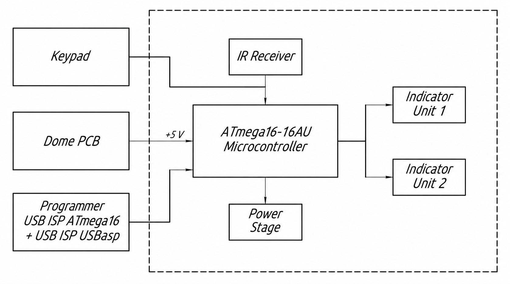
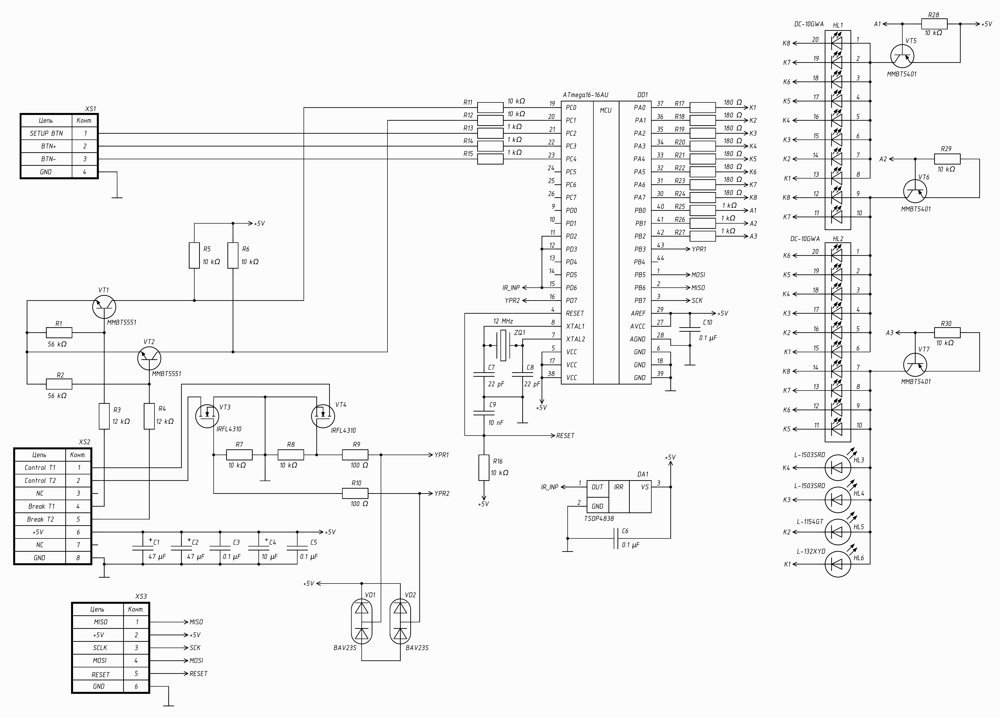
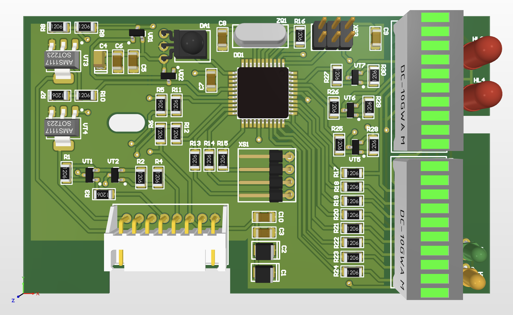
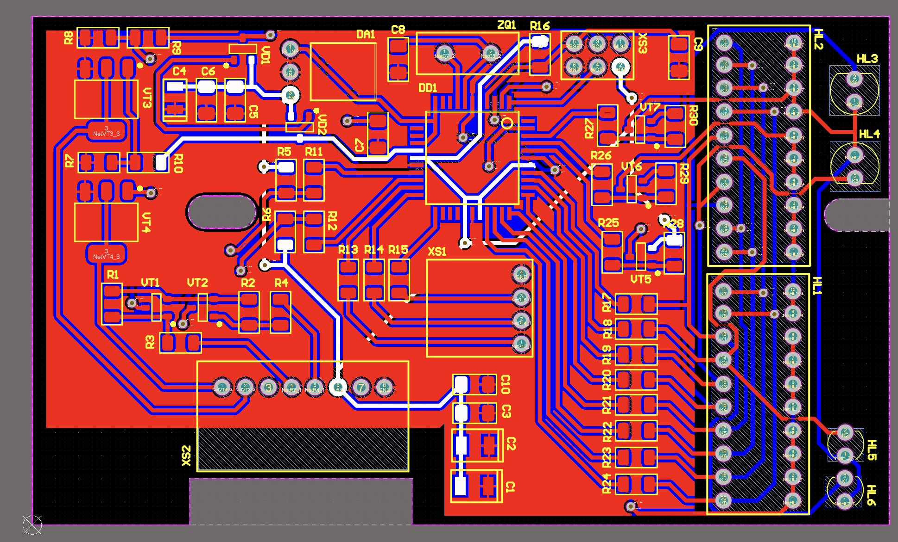
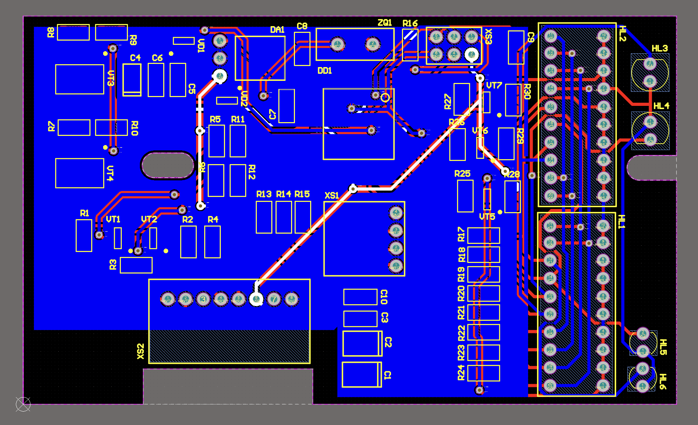
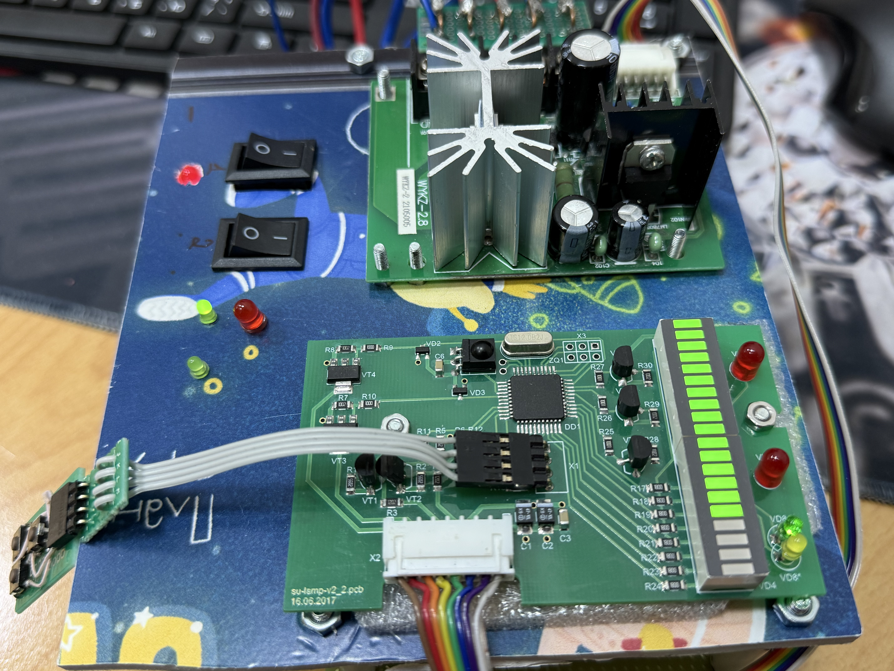

# Control Board

ATmega16-based control and indication board for a luminaire with main and backup incandescent lamps. The board reads the control-panel keypad, sends brightness and lamp-selection commands to the external power board, and displays operating status on the panel.

When the power board reports a main-lamp failure, the intended control sequence commands the backup lamp to turn on. The board also provides a second feedback channel for the backup lamp.

## Features

- ATmega16-16AU microcontroller with a 12 MHz external crystal.
- External +5 V supply received from the power board.
- Three keypad inputs: setup, increase, and decrease.
- TSOP4838 infrared receiver for remote-control input.
- Two transistor output stages for main- and backup-lamp commands.
- Two transistor-conditioned lamp-feedback inputs.
- Two 10-segment LED bar graphs and four discrete status LEDs, arranged in three multiplexed groups.
- Six-pin AVR ISP programming connector.

## My Contribution

This project is based on a board design created before my involvement. I transferred the existing design to **Altium Designer** and prepared the schematic, PCB layout, component libraries, bill of materials, and engineering documentation.

My work included component selection, standardizing schematic symbols and footprints, clarifying component parameters, and aligning the schematic, PCB, and documentation. I also **personally assembled and soldered the board**.

## Block Diagram

The keypad and IR receiver provide user input to the microcontroller. The controller drives the indicators and the two command-output stages. The external power board supplies +5 V, switches the lamp current, and returns lamp-feedback signals.

## Schematic

VT1 and VT2 condition the Break T1 and Break T2 feedback signals before they reach PC0 and PC1. VT3 and VT4 interface the microcontroller outputs to Control T1 and Control T2. VD1 and VD2 provide diode-clamp networks on the output-control lines.

The indication circuit shares eight cathode lines through R17–R24 and selects three anode groups using VT5–VT7. This permits multiplexed operation of the two bar graphs and four status LEDs. The microcontroller controls the display patterns and multiplexing sequence.

### Connections

| Connector | Pin | Signal |
| --- | --- | --- |
| XS1 — keypad | 1 | SETUP BTN |
| XS1 | 2 | BTN+ |
| XS1 | 3 | BTN− |
| XS1 | 4 | GND |
| XS2 — power board | 1 | Control T1 |
| XS2 | 2 | Control T2 |
| XS2 | 3 | NC |
| XS2 | 4 | Break T1 |
| XS2 | 5 | Break T2 |
| XS2 | 6 | +5 V input |
| XS2 | 7 | NC |
| XS2 | 8 | GND |
| XS3 — AVR ISP | 1 | MISO |
| XS3 | 2 | +5 V |
| XS3 | 3 | SCK |
| XS3 | 4 | MOSI |
| XS3 | 5 | RESET |
| XS3 | 6 | GND |

## PCB

### 3D View

### Top Layer

### Bottom Layer

Two-layer PCB with surface-mount control circuitry and through-hole connectors, indicators, IR receiver, and crystal.

## Assembled Board and Test Bench

The photograph shows the assembled control board in the foreground, with the power board mounted behind it. The illuminated LED bar graphs and status indicators show the panel operating on the demonstration stand. The keypad is connected by a separate cable.

### Hardware and Documentation Versions

The photographs show hardware that I assembled and soldered. Some photographed boards are earlier versions and may differ from the published Altium files in component placement, markings, or implementation details. The Altium files and engineering documents describe the version prepared during my work on the project.

## Bill of Materials

[Download BOM (CSV)](docs/control-board.csv)

| Reference | Qty | Value / Part | Description | Manufacturer | Part Number | Package |
| --- | ---: | --- | --- | --- | --- | --- |
| C1, C2 | 2 | 4.7 µF | Tantalum capacitor, 10 V, 10% | Vishay | 293D475X9010A2TE3 | 1206 |
| C3, C5, C6, C10 | 4 | 0.1 µF | Ceramic capacitor, 250 V, 10% | Yageo | CC1206KKX7RYBB1041 | 1206 |
| C4 | 1 | 10 µF | Tantalum capacitor, 10 V, 10% | Kyocera AVX | TAJC106K010RNJ | 1206 |
| C7, C8 | 2 | 22 pF | Ceramic capacitor, 50 V, 5% | Murata | GRM3165C1H220JD01D | 1206 |
| C9 | 1 | 10 nF | Ceramic capacitor, 50 V, 10% | Yageo | CC1206KRX7R9BB103 | 1206 |
| DA1 | 1 | TSOP4838 | Infrared receiver, 38 kHz | Vishay | TSOP4838 | THT |
| DD1 | 1 | ATmega16-16AU | 8-bit AVR microcontroller, 16 MHz, 16 KB Flash | Microchip | ATmega16-16AU | TQFP-44 |
| HL1, HL2 | 2 | DC-10GWA | LED bar-graph display | Kingbright | DC-10GWA | THT |
| HL3, HL4 | 2 | L-1503SRD | Red LED | Kingbright | L-1503SRD | THT |
| HL5 | 1 | L-1154GT | Green LED | Kingbright | L-1154GT | THT |
| HL6 | 1 | L-132XYD | Yellow LED | Kingbright | L-132XYD | THT |
| R1, R2 | 2 | 56 kΩ | Chip resistor, 0.25 W, 1% | Yageo | RC1206FR-0756KL | 1206 |
| R3, R4 | 2 | 12 kΩ | Chip resistor, 0.25 W, 5% | Yageo | RC1206JR-0712KL | 1206 |
| R5, R6, R7, R8, R11, R12, R16, R28, R29, R30 | 10 | 10 kΩ | Chip resistor, 0.25 W, 1% | Yageo | AC1206FR-0710KL | 1206 |
| R9, R10 | 2 | 100 Ω | Chip resistor, 0.25 W, 5% | Yageo | RC1206JR-07100RL | 1206 |
| R13, R14, R15, R25, R26, R27 | 6 | 1 kΩ | Chip resistor, 0.25 W, 1% | Yageo | RC1206FR-071KL | 1206 |
| R17, R18, R19, R20, R21, R22, R23, R24 | 8 | 180 Ω | Chip resistor, 0.25 W, 1% | Yageo | RC1206FR-07180RL | 1206 |
| VD1, VD2 | 2 | BAV23S | Dual switching diode | ON Semiconductor | BAV23S | SOT-23 |
| VT1, VT2 | 2 | MMBT5551 | NPN bipolar transistor, 160 V, 0.6 A | UMW | MMBT5551 | SOT-23 |
| VT3, VT4 | 2 | IRFL4310 | N-channel MOSFET, 100 V | JSMicro | IRFL4310 | SOT-223 |
| VT5, VT6, VT7 | 3 | MMBT5401 | PNP bipolar transistor, 150 V, 0.6 A | UMW | MMBT5401 | SOT-23 |
| XS1 | 1 | PLS-4R | 4-pin connector (socket) | Connfly Electronics | DS1022-1*4RDF11-B | THT |
| XS2 | 1 | CWF-8R | 8-pin connector (socket) | Connfly Electronics | DS1069-8MRW6XB | THT |
| XS3 | 1 | PLD-6 | 6-pin connector (plug) | Connfly Electronics | DS1021-2*3SF11-B | THT |
| ZQ1 | 1 | 12 MHz | Quartz crystal resonator | SJK | SJK-6B-12.000-16-30-50-C-50-H | THT |

## Documentation (Russian)

- [Block diagram (E1)](docs/original-ru/control-board_E1_block-diagram.pdf)
- [Circuit schematic (E3)](docs/original-ru/control-board_E3_schematic.PDF)
- [Parts list (PE3)](docs/original-ru/control-board_PE3_part-list.pdf)
- [PCB drawing](docs/original-ru/control-board_PP_board-drawing.PDF)
- [Assembly drawing](docs/original-ru/control-board_SB_assembly-drawing.pdf)
- [Specification](docs/original-ru/control-board_SP_specification.pdf)

## Design and Fabrication Files

- [Altium Designer project](hardware/altium/control-board.PrjPcb)
- [Altium schematic](hardware/altium/control-board_E3_schematic.SchDoc)
- [Altium PCB](hardware/altium/control-board.PcbDoc)
- [Component libraries](hardware/altium/libs/)
- [Gerber archive](fabrication/control-board_gerber.zip)
- [STEP model](fabrication/control-board.step)
